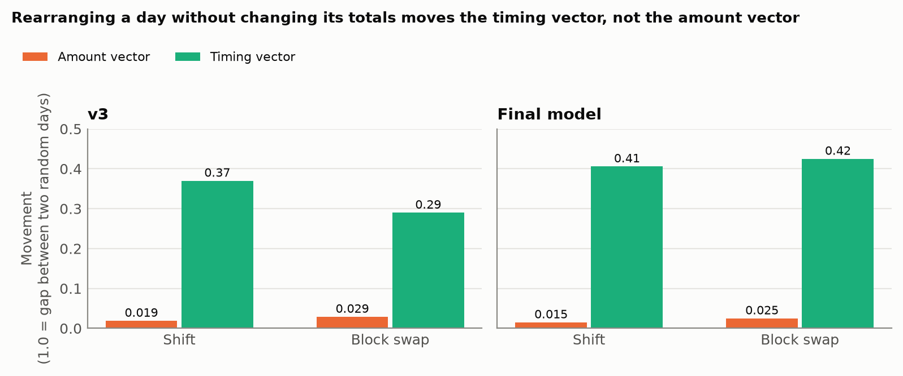
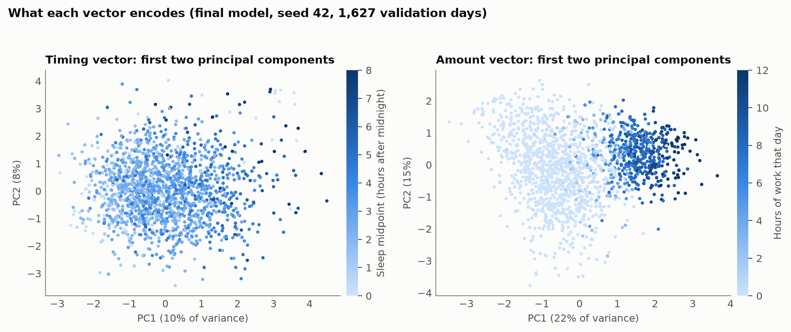
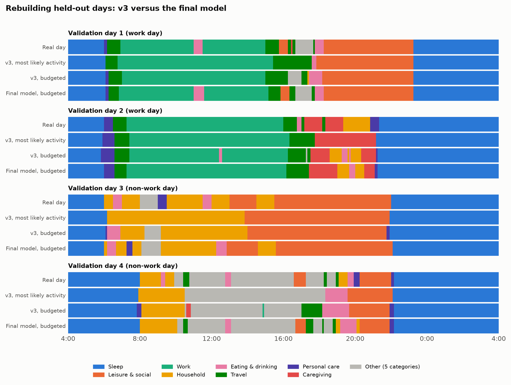
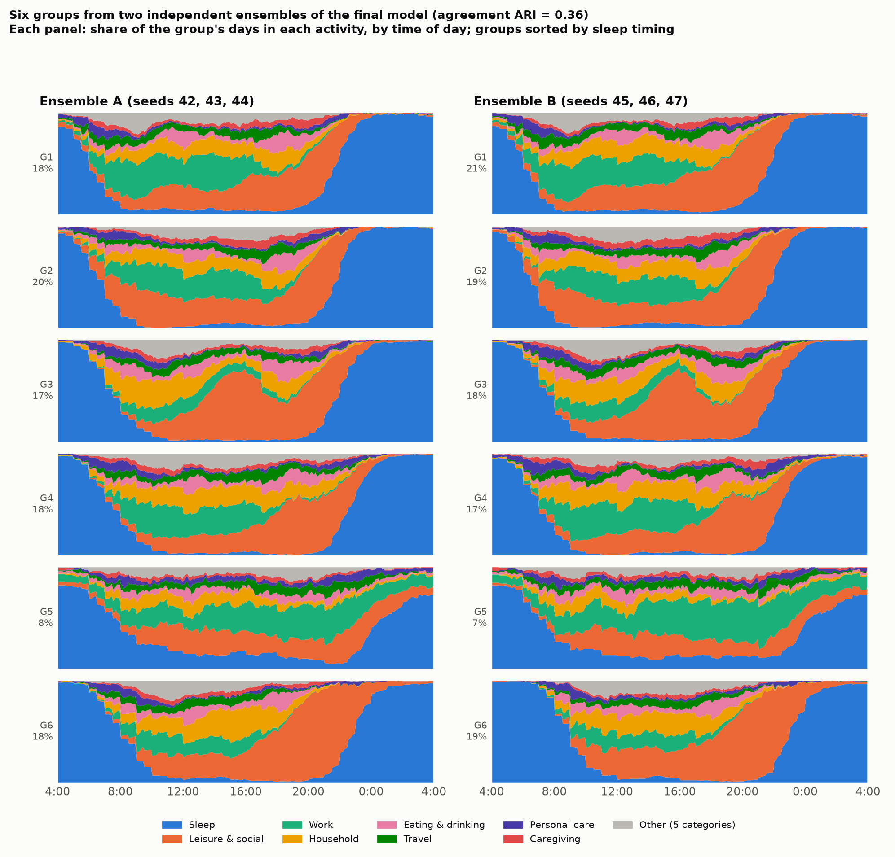
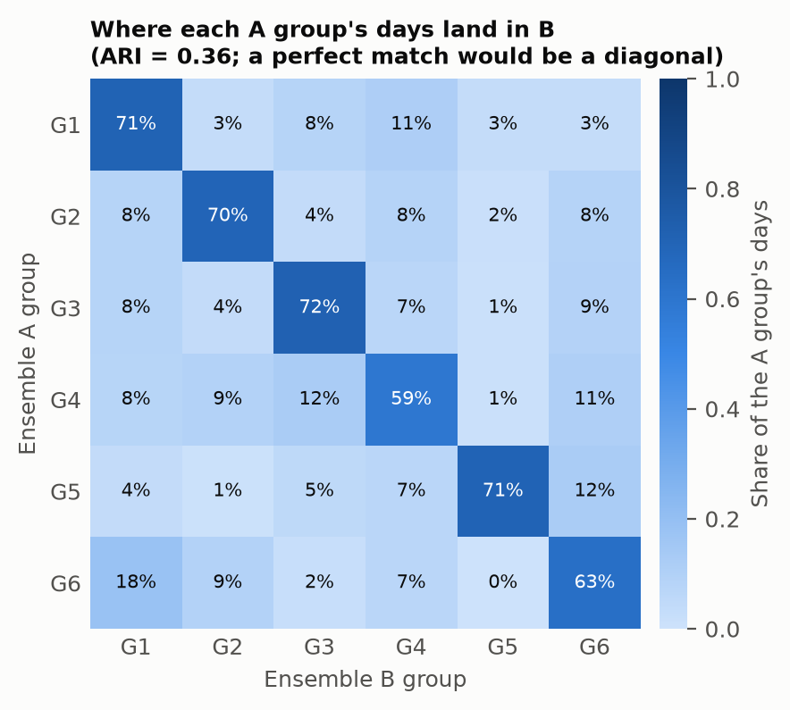
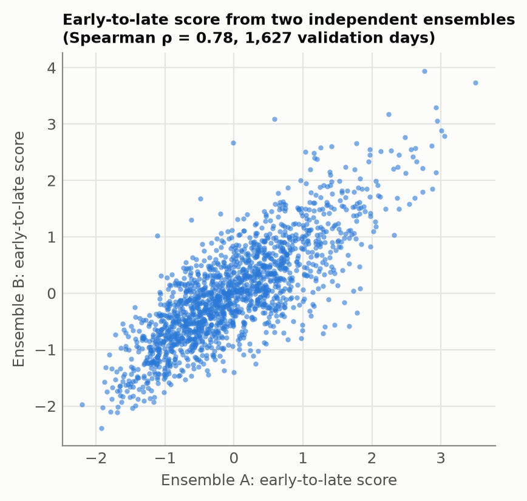
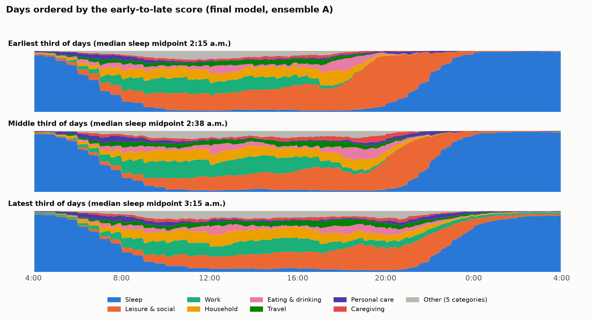

# Experiments and Results (draft for the final paper)

Aim: about 2 to 2.5 pages including tables. Three tables are suggested; cut Table 3 or move it to the appendix if
space is tight. All numbers below are copied from the repo documents named at the end.

## Protocol

We fixed every modeling choice on the 2022 validation split, then scored each held-out year once. Before each
test we wrote down the success criteria, had them approved, and stored checksums of the code, configuration
and trained models, so nothing could be adjusted after seeing the results. The first version of the model (v1)
was tested on 2023 (8,548 diaries), the structured alternative (v2) on 2024 (7,669 diaries), and the final
version (v3) on 2025 (6,146 diaries, no October data because of the federal shutdown). Each model was trained
with three or more random seeds, and we report the mean and standard deviation across seeds. Probes, scalers
and cluster centers are always fitted on 2022 training days only. All counts are unweighted, so they describe
the survey sample and not the U.S. population.

After these tests we enlarged the model and its training data to address oversmoothing (Section [Method: Choosing
the model size and data]). The final model has about 1.09 million parameters and is trained on the 2022 training
split together with all of 2023 and 2024. Because 2023 and 2024 had already served as test years, they became
training data only after those tests. 2025 is the only year the final model has not seen, but it had already been
used once to test v3, so the final model's 2025 results are a second evaluation of that year rather than a fresh
test. As before, we wrote down the checks and their pass lines before scoring 2025. All final-model numbers marked
"2022 validation" were used to make choices; the 2025 numbers were not.

We compare against four baselines from the same pipeline: k-means on activity totals, k-means on hand-built
timing features, a VAE with one joint vector of 24 numbers (the standard design closest to ours), and our
model without the invariance term. We also report an untrained network of the same shape, to show what the
architecture gives without learning. We did not reimplement Li and Mandt (2018) directly, because their model
splits a sequence into fixed and per-frame parts, which does not match our question; the joint VAE plays the
role of the standard alternative.

## Experiment 1: Does the model separate amount from timing?

We measure separation in four ways. First, we rearrange held-out days without changing their totals and
measure how far each vector moves, relative to the typical distance between two random days (pair
sensitivity). Second, we use nearest-neighbor probes to check whether the activity totals can be read from the
amount vector, and whether clock-timing features can be read from each vector beyond what the totals already
tell us. Third, we take two days with nearly identical totals, give the decoder one day's amount vector and the
other day's timing vector, and check whose timing the rebuilt day follows (the swap test).

Table 1 shows the 2023 results for v1. The amount vector reads the totals well (R² 0.85, against 0.71 for an
untrained network) and carries almost no timing beyond them (0.008). Rearranging a day moves it by only 0.02
to 0.03, less than half as much as without the invariance term. The timing vector carries timing beyond the
totals (0.24, against 0.002 untrained), and in the swap test the rebuilt timing follows the day that supplied
the timing vector 79% of the time, against 67% for a model trained without guidance and 50% for chance. The
same pattern held on 2025 for v3, where the stronger tree probes give a totals R² of 0.92 for the amount vector,
0.015 timing leakage, and a timing gain of 0.62 for the timing vector. The decoder depends on both vectors:
replacing either one with another day's vector raises the reconstruction error to four to six times its
normal value (3.43 for the amount vector and 2.30 for the timing vector, against 0.57).

The split did not create extra timing information. The joint model's single vector holds about as much timing
as our timing vector (0.23 against 0.24), so this pre-registered criterion failed. What the split adds is an
organization of the information, with a part that tracks totals and ignores rearrangement, not more of it.

**Table 1.** Separation on 2023 (v1, mean ± SD over 3 seeds).

| Measure | Ours | No invariance | No guidance | Joint vector | Untrained |
| --- | ---: | ---: | ---: | ---: | ---: |
| Amount vector moves under shift (lower is better) | 0.019 ± 0.000 | 0.043 ± 0.002 | 0.293 ± 0.028 | | 0.012 |
| Amount vector moves under swap | 0.028 ± 0.002 | 0.060 ± 0.003 | 0.316 ± 0.046 | | 0.009 |
| Totals read from amount vector (R²) | 0.849 ± 0.001 | 0.829 ± 0.011 | 0.328 ± 0.066 | | 0.714 |
| Timing leaked into amount vector | 0.008 ± 0.001 | 0.014 ± 0.003 | 0.106 ± 0.011 | | 0.003 |
| Timing beyond totals in timing vector | 0.237 ± 0.014 | 0.242 ± 0.006 | 0.205 ± 0.009 | 0.229 ± 0.012 | 0.002 |
| Swap test: rebuilt timing follows timing vector | 0.789 ± 0.008 | 0.793 ± 0.002 | 0.672 ± 0.012 | | 0.499 |

*(The untrained amount vector barely moves because it barely encodes anything; it fails the totals row.)*

*Figure 3. Movement of each vector when a validation day is shifted or has two blocks swapped, relative to the typical distance between two random days (six-seed means, 2022 validation). The amount vector stays almost still while the timing vector moves.*

*Figure 4. The first two principal components of each vector for 1,627 validation days (final model, seed 42). The amount vector separates days by hours of work; the timing vector shows a gradient with sleep timing.*

## Experiment 2: Ablations and sensitivity to the loss weights

Comparing the columns of Table 1 separates the two guidance terms. The amount prediction head does most of the
work: adding it alone raises the totals R² of the amount vector from 0.33 to 0.83 and cuts its movement under
rearrangement from about 0.3 to about 0.05. The invariance term then halves that movement again, at a cost of
about 2% in reconstruction error (cross-entropy 0.454 against 0.444).

We chose the invariance weight with a rule fixed in advance: the strongest weight whose validation
reconstruction error stays within 5% of the model without invariance. On the full 2022 data, with three seeds
each, λ = 1 raised the error by 11%, λ = 0.3 by 3.7% and λ = 0.1 by 3.9%, with average amount movement of
0.014, 0.024 and 0.033. The rule selected λ = 0.3. An earlier choice of λ = 1 on a 400-diary subset did not
hold at full scale, which is why we reran the sweep before testing.

During v3 development we also tested three changes on 2022 validation and rejected all of them: more realistic
local rearrangements instead of whole-day shifts, direct supervision of the timing vector with hand-built
timing features, and a stronger KL penalty on the timing vector. None improved group reliability enough to
justify its cost in information or reconstruction.

## Experiment 3: Rebuilding days

Rebuilt days with v1's slot-by-slot decoding are accurate per slot but too smooth. On 2023 the model labels 84%
of slots correctly (macro-F1 0.67), but a rebuilt day has about 7 activity changes against about 15 in a real
day, and short activities such as meals disappear. The budgeted decoding of v3 fixes most of this without
retraining. On 2025 it gives 12.8 activity changes per day against 15.1 in real days, and lowers the average
error in activity minutes from 25.6 to 10.3. The structured v2, which builds the totals into the decoder, was
the best model of individual days on 2024 (lowest cross-entropy, 0.409; 15.0 activity changes against 14.8;
duration error 9.8 minutes), but its timing vector was harder for probes to read (0.55 against 0.64 for v1), so
we kept the v1 design with budgeted decoding.

The final model, with the same design but a larger network and three years of training data, rebuilds days far
better. On 2022 validation, averaged over six seeds, its reconstruction cross-entropy falls from 0.546 to 0.311,
and its budgeted macro-F1 rises from 0.60 to 0.76. Meals, the clearest victim of oversmoothing, are now placed
within 15 minutes of their true time with an F1 of 0.81, against 0.49 for v3. The average error in activity minutes
falls from 9.9 to 7.3, and rebuilt days have 13.5 activity changes against 14.8 in real days (12.6 for v3). Even
the slot-by-slot decoding improves, from 5.8 to 9.7 activity changes per day, so part of the oversmoothing came
from a model that was too small and trained on too little data. [Insert 2025 values for the final model once
scored.]

*Figure 5. Four validation days chosen at random (two work days, two non-work days), rebuilt by v3 with slot-by-slot and budgeted decoding and by the final model with budgeted decoding. Slot-by-slot decoding drops short activities; the final model keeps most of them in the right place.*

## Experiment 4: Do the timing vectors form stable groups?

We cluster days into six groups with k-means and measure reliability with the adjusted Rand index (ARI)
between groupings of the same days from models trained with different seeds. A value of 1 means identical
groups and 0 means chance agreement. We also check whether the groups split days with similar totals by timing,
using the ratio of the sleep-midpoint difference between days placed in different groups and days placed
together.

The learned groups are readable. They separate, for example, daytime sleepers, late starters and full daytime
work days, and their average minutes per activity are similar while their clock timing differs. They are not
stable, however (Table 2). Single v1 models agree at an ARI of only 0.26, while groups from hand-built timing
features agree at 0.76. Combining three models (v3) doubles the agreement to 0.36 on 2025 but stays well below
the hand-built features (0.82). The ensemble groups do separate days with similar totals by rhythm more
strongly than the hand-built groups: days they split differ about twice as much in sleep midpoint as days they
keep together (ratio 2.0), against 1.28 for the hand-built features.

The final model keeps the ensemble reliability of v3 but loses part of this rhythm advantage. On 2022 validation
its two ensembles agree at an ARI of 0.36, close to v3's 0.38, even though its single models agree less (0.12
against 0.19). Its groups, however, follow sleep timing less directly: the sleep-midpoint ratio falls from 1.9 and
2.2 for v3's two ensembles to 1.56 and 1.47, still above the hand-built features (1.20 on the same validation
pairs) but no longer clearly ahead of them. One ensemble narrowly misses the pass line of 1.5. The larger model
seems to describe days in finer detail along directions other than sleep timing, so k-means cuts on its timing
vector follow the sleep rhythm less closely. We report this as a trade-off: the larger model rebuilds days much
better, while its groups are about as reproducible but less tied to sleep timing.

**Table 2.** Group reliability (ARI between groupings of the same days).

| Representation | ARI | Year |
| --- | ---: | --- |
| v1 timing vector, single models | 0.257 ± 0.004 | 2023 |
| Joint vector, single models | 0.279 ± 0.020 | 2023 |
| v2 timing vector, single models | 0.225 | 2024 |
| v3 ensembles of 3 models (A vs B) | 0.360 | 2025 |
| Final model, single models | 0.124 | 2022 validation |
| Final model, ensembles of 3 models (A vs B) | 0.364 [2025: insert] | 2022 validation |
| Hand-built timing features | 0.761 ± 0.067 (2023), 0.818 (2025) | 2023, 2025 |

**Table 3.** The 16 pre-registered v3 checks for v3 and the final model. Six models per version; ensembles
A = seeds 42-44, B = 45-47. Probes, scalers and centroids fitted on 2022 training days only.

| Check | Pass line | v3, 2022 val. | v3, 2025 | Final, 2022 val. | Final, 2025 |
| --- | --- | ---: | ---: | ---: | ---: |
| S1 Totals readable from amount vector (R²) | ≥ 0.85 | 0.916 | 0.923 | 0.906 | [ ] |
| S2 Timing in amount vector | ≤ 0.05 | 0.014 | 0.015 | 0.004 | [ ] |
| S3 Timing beyond totals in timing vector | ≥ 0.50 | 0.627 | 0.618 | 0.599 | [ ] |
| S4 Totals in timing vector | ≤ ½ of clock features | 0.285 | 0.279 | 0.243 | [ ] |
| S5a Error with another day's amount vector | ≥ 2 × own | 3.48 (own 0.55) | 3.43 (own 0.57) | 4.01 (own 0.31) | [ ] |
| S5b Error with another day's timing vector | ≥ 2 × own | 2.18 | 2.30 | 3.06 | [ ] |
| S6a Amount moves under shift | ≤ ¼ of timing | 0.019 | 0.019 | 0.015 | [ ] |
| S6b Amount moves under swap | ≤ ¼ of timing | 0.029 | 0.029 | 0.025 | [ ] |
| P1 Ensembles agree (ARI) | ≥ 0.30 | 0.384 | 0.360 | 0.364 | [ ] |
| P2 Ensembles beat single models | ≥ 1.5 × single | 0.384 | 0.360 | 0.364 | [ ] |
| P3a Sleep-midpoint ratio, ensemble A | ≥ 1.5 | 1.93 | 2.00 | 1.56 | [ ] |
| P3b Sleep-midpoint ratio, ensemble B | ≥ 1.5 | 2.19 | 1.95 | **1.47** | [ ] |
| P4 Group splits follow timing (AUC) | ≥ 0.58 | 0.611 | 0.589 | 0.591 | [ ] |
| P5 As reliable as hand-built features | ≥ 0.82 | **0.384** | **0.360** | **0.364** | [ ] |
| R1 Activity changes per rebuilt day | within 20% of real | 12.6 | 12.8 | 13.5 | [ ] |
| R2 Duration error, budgeted (minutes) | ≤ 0.6 × argmax | 9.9 | 10.3 | 7.3 | [ ] |
| **Checks met** | | **15 of 16** | **15 of 16** | **14 of 16** | [ ] |

*Bold values miss their pass line. The R2 pass line for the final model is stricter than for v3 because its
slot-by-slot decoding is already much better (12.8 against 25.2 minutes).*

*Figure 6. The six groups found by two independent ensembles of the final model (A = seeds 42-44, B = seeds 45-47), shown as the share of each activity by time of day. Group numbers in B are matched to A for display only.*

*Figure 7. Where each ensemble-A group's validation days land in ensemble B. Between 59% and 72% of each group's days stay together (ARI 0.36); a perfect match would be a diagonal of 100%.*

## Experiment 5: Why the groups are unstable (2022 validation only)

These follow-up checks were done after the test years had been used, so they come from 2022 validation data
only and are exploratory. Unless stated otherwise they use the v3-size models. We varied the number of groups from 2 to 10 and found no k with clearly better
reliability (about 0.3 to 0.4 throughout). A model that learns groups inside its prior (a Gaussian mixture on
the timing vector) agreed across seeds at only 0.16 to 0.19, and was more reproducible on simulated data with no
groups at all (0.31). This null check shows that moderate agreement alone is not evidence of real types.

The evidence points to timing varying along a continuum. When we instead give each day a score on the main
direction of variation in the timing vectors, aligned across nine v3-size models, the scores agree closely
(Spearman ρ = 0.90 between independent model sets, with 78% of days in the same third). This axis runs from
earlier-shifted to later-shifted days and is nearly unrelated to the activity totals (|ρ| ≤ 0.16). The final
model reproduces the axis less closely: its two ensembles agree at ρ = 0.78, with 65% of days in the same third
(Cohen's κ 0.48, against 0.67 for the v3-size models), and the axis stays unrelated to the totals (|ρ| ≤ 0.20).
This is still far more consistent than its hard groups (ARI 0.36), so the continuum reading holds for the larger
model as well, but its main timing direction is a weaker summary of sleep timing (ρ = 0.37 with the sleep
midpoint), in line with its weaker sleep-midpoint ratio in Experiment 4. Grouping by
what a day is spent on, rather than when, gives five very stable types (bootstrap ARI 0.93): work, leisure,
home and chores, religious or volunteer, and school days. Specific patterns can also be read from the timing
vector of the v3-size models: a probe separates night-work days with AUC 0.98, and naps with AUC 0.95. Day of week explains at most
1.1% of the rhythm axes, and survey weights barely change the rhythm results, though they do change the
activity amounts.

*Figure 8. Early-to-late score for each validation day from two independent ensembles of the final model (Spearman ρ = 0.78). The models largely agree on the order of days even though their hard groups agree only moderately. The ρ = 0.90 in the text is for consensus sets of nine v1 models; the larger final model agrees less on this axis, consistent with its groups following sleep timing less directly.*

*Figure 9. The average validation day in the earliest, middle and latest third by the early-to-late score (final model, ensemble A; cut points fixed on training days).*

## Summary of findings

Across three held-out years, the separation between amount and timing worked as designed and transferred
without loss. The model rebuilds days well once short activities are given their expected time, and a larger
network trained on more years of data rebuilds them far better while keeping the separation clean. The split does
not add timing information beyond a single joint vector, and hard groups from the timing vectors are less
reliable than groups from hand-built features, for the smaller and the larger model alike. Follow-up analysis
suggests the reason is that daily timing is a continuum, which the timing vector describes well as a continuous
scale but not as separate types. The larger model's groups follow sleep timing less directly than v3's.

---

*Sources: `docs/final_results_test.md` and `docs/checkpoint5_results.md` (2023), `docs/v2_test_results.md`
(2024), `docs/v3_test_results.md` (2025), `docs/checkpoint5_robustness_notes.md` (λ sweep),
`docs/v3_results.md`, `docs/v4_results.md`, `docs/continuum_axes.md`, `docs/two_level_types.md`,
`docs/patterns.md`, `docs/weekday_weekend.md`, `docs/weighted_sensitivity.md`. Final model:
`docs/v3_mbig2_final_val.md` (16 checks, 2022 validation), `docs/v3_final_val.md` (v3 on the same checks),
`docs/v3_final_ensembles.md` (ensembles), `docs/v3_round5_results.md`.*
